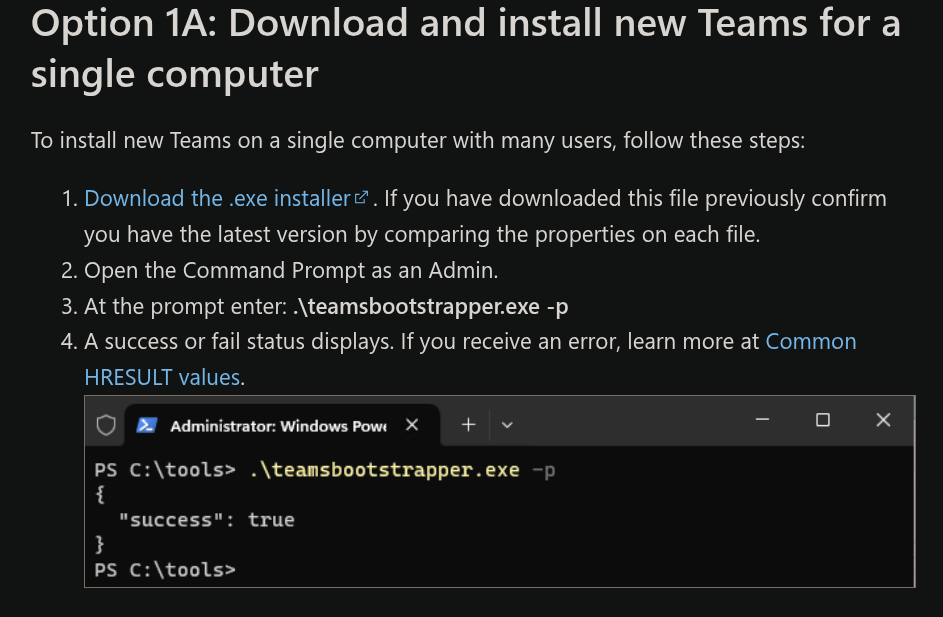

# Intro

We create a temporary local Windows account (python_course) to provide a sandbox-like environment for learning Python.

 - `Safety` – reduce the risk of accidentally changing or damaging your everyday Windows environment.
 - `Isolation` – keep course files, settings, and installed tools separate from your personal account.
 - `Consistency` – minimize problems caused by different software configurations on students' computers.
 - `Easy installation` – install most course tools only for the new user, whenever possible.
 - `Easy cleanup` – remove the account and its data after the course without affecting your personal files and settings.

Note:
This is not a fully isolated sandbox. Some applications, such as Microsoft Teams, are installed system-wide and remain
available after the course.

# Contents

 - [Microsoft Teams](#microsoft-teams)
 - [New account](#new-account)
 - [git installation](#git-installation)
 - [Account setup](#account-setup)

# Microsoft Teams

Usually, each user of the system must install Microsoft Teams individually. To avoid this situation, you can install a
version available to each computer user:
 >- in the browser, open this [link](https://learn.microsoft.com/en-us/microsoftteams/teams-client-bulk-install#:~:text=Option%201A%3A%20Download%20and%20install%20Teams%20for%20a%20single%20computer)
 >- click on `Download the .exe installer` and download the file
 >- open the PowerShell program as an administrator
 >- go to the Downloads directory, e.g. if your username is `john`, type: `cd C:\Users\john\Downloads`
 >- run the installer as shown in the image (`.\teamsbootstrapper.exe -p`)

# New account

To create a new local Windows account:

> - press the `Windows` key and type `settings` on your keyboard

> - go to `Accounts → Other users` and press `Add account`

> - click `I don't have this person's sign-in information`

> - click `Add a user without a Microsoft account`

> - enter the account name (in the example it is `python_course`)
> - no password is required for the account - you can set it or not
> - keep the account as a standard user (not an administrator)

---

# Account setup
Log in to the new account (in the example it is `python_course`) and:
 1. Go back to settings
 2. Go to the `System/For developers` tab and activate the options shown in the pictures below:
 >- `Developer Mode On`
 >- `File Explorer\Show file extension On`
 >- `File Explorer\Show full path in title bar On`
 >- `Terminal Windows Terminal`
 >- `PowerShell\Change execution policy ... On`

---

# git installation

Currently, scientific work is based on teamwork, which causes:
- multiple people operating on the same documents
- splitting documents and merging them
- working on multiple versions of documents

For this purpose, the course will use an open source tool - `git`. From [git page](https://git-scm.com/):
>Git is a free and open source distributed version control system designed to handle everything from small to very
large projects with speed and efficiency.

**Git installation is optional for this course.**

Open [link](https://git-scm.com/downloads) and choose one of the installation options:

- **For a selected user account** – download `PortableGit`, extract it to a directory in the user's account
(e.g. `C:\Users\python_course\Git`) and use `git-bash.exe`. Administrator privileges are not required.
- **For all users** – download the standard Git installer and install `git` as an administrator. Git will be available
to all users of the computer.

