# Jupyter project

From [Project Jupyter Documentation](https://docs.jupyter.org/en/latest/):
>Welcome to the Project Jupyter documentation site. Jupyter is a large umbrella project that covers many different
software offerings and tools, including the popular Jupyter Notebook and JupyterLab web-based notebook authoring and
editing applications. The Jupyter project and its subprojects all center around providing tools (and standards) for
interactive computing with computational notebooks.

# Installation

## Directory structure

During the course, we will use the following organization:

- each project usually has its own virtual environment, regardless of whether it contains scripts or notebooks
- for interactive work and experiments in Jupyter, we use shared environments (e.g. `edc`)
- notebooks not related to a specific project are stored in `jupyter/notebooks`
- project notebooks are stored in the project directory and use the project's own environment

```plaintext
C:\Users\my_account\python_course\    - main python course folder
|
+---\data\                            - data shared between projects
|
+---\imgs\                            - images shared between projects
|
+---\projects\                        - directory with exercises/projects
|
+---\jupyter\                         - includes notebooks and jupyter environments
    |
    +---\envs\                        - directory for storing shared Jupyter virtual environments
    |   |
    |   +----\jupyter_base\           - jupyter runtime environment
    |   |
    |   +----\edc\                    - sample environment for everyday work (numpy, pandas, scipy, matplotlib)
    |
    +---\notebooks\                   - notebooks not related to any project
```

## Creating directories

In the python course directory, create the following directories (according to the structure shown):

1. `mkdir jupyter`

   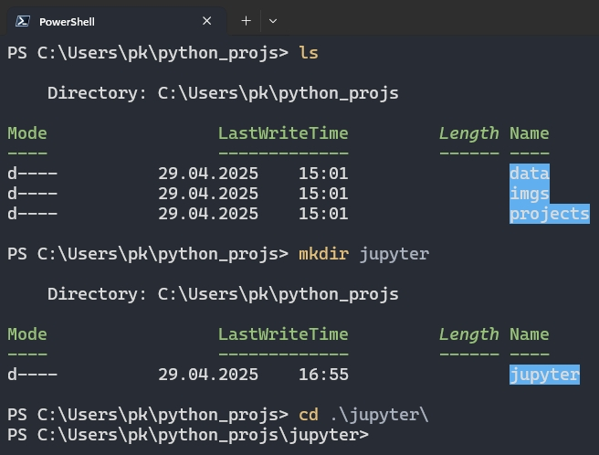

2. `cd jupyter` -> `mkdir envs` and `mkdir notebooks`

   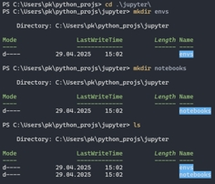

## Jupyter base

Create `jupyter_base` virtual environment: this is your main environment from which Jupyter will be launched. The environment is:

- used to manage Jupyter
- not used for work - no other modules will be installed in it except those necessary for Jupyter itself to run

Go to the `envs` directory:

```bash
cd envs
```

Create the environment:

- Windows: `python -m venv jupyter_base`
- Linux: `python3 -m venv jupyter_base`
- macOS: `python3.14 -m venv jupyter_base`

**Note:** On macOS, the Python version number depends on the version installed on your computer.

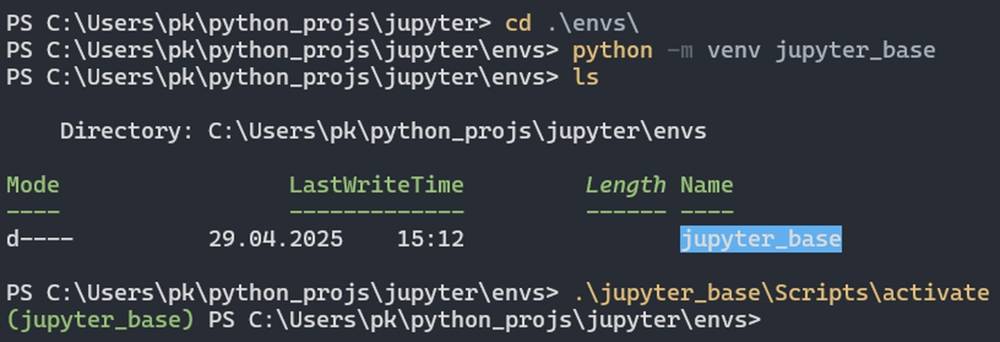

## Jupyter installation

From the main `python_course` directory, go to `jupyter` and activate `jupyter_base`:

Windows (PowerShell):

```powershell
cd jupyter
envs/jupyter_base/Scripts/activate
```

Linux / macOS:

```bash
cd jupyter
source envs/jupyter_base/bin/activate
```

Install Jupyter:

```bash
python -m pip install -U pip jupyter
```

The `jupyter` package installs JupyterLab, Jupyter Notebook, IPython, `ipykernel`, `nbconvert` and other Jupyter tools.

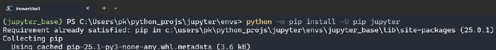
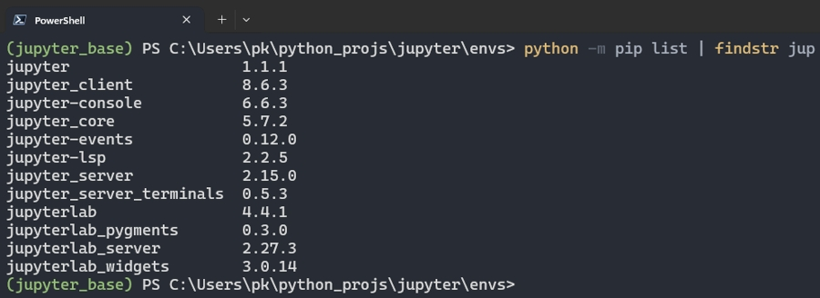

# Jupyter and virtual environments

In Jupyter, virtual environments can be used as separate `Python kernels`. Each kernel allows notebooks to run code
using Python and the modules installed in a selected environment.

For an environment to be available as a `kernel`, it must:

> - have the `ipykernel` module installed
> - be registered in Jupyter

## Edc environment

An environment for everyday work, with popular data analysis modules installed - list of modules in the file `edc_requirements.txt`.

1. Create `edc` environment:

   > - deactivate `jupyter_base` if it is active
   > - go to the `jupyter/envs` directory
   > - create a new environment:

   - Windows: `python -m venv edc`
   - Linux: `python3 -m venv edc`
   - macOS: `python3.14 -m venv edc`

   Activate the environment:

   - Windows: `edc/Scripts/activate`
   - Linux / macOS: `source edc/bin/activate`

   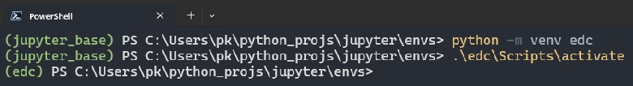

2. `edc_requirements.txt`

   > Copy the file `edc_requirements.txt` to the `jupyter/envs` directory.

   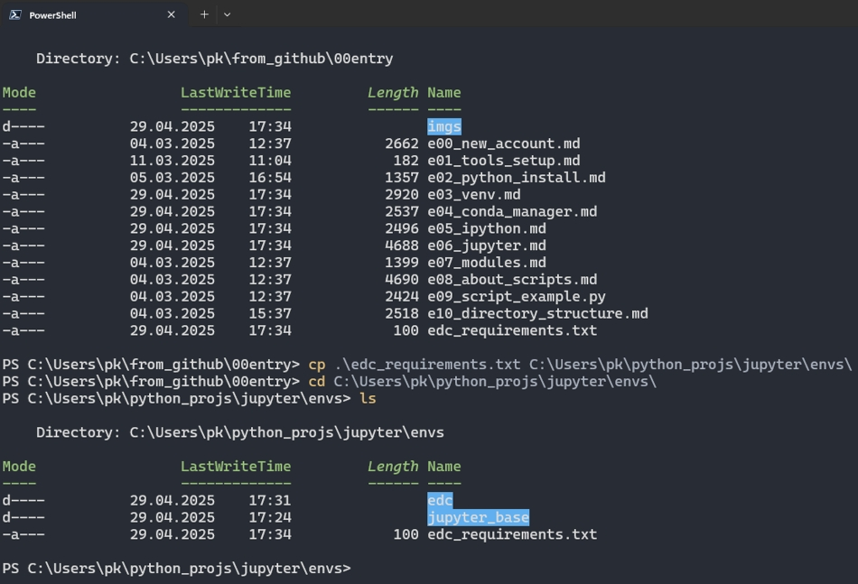

3. Install modules from `edc_requirements.txt` file:

   ```bash
   python -m pip install -r edc_requirements.txt
   python -m pip install ipykernel
   ```

   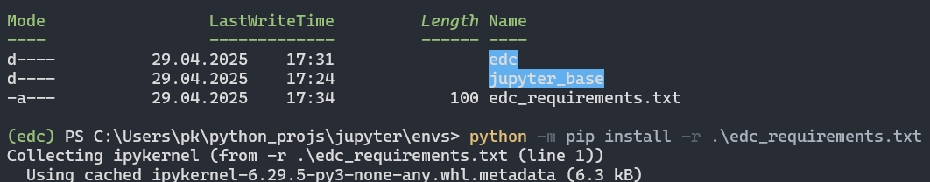
   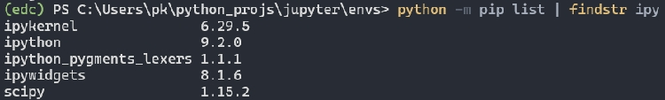

4. Install the environment in Jupyter:

   ```bash
   python -m ipykernel install --user --name=edc --display-name "python_edc"
   ```

   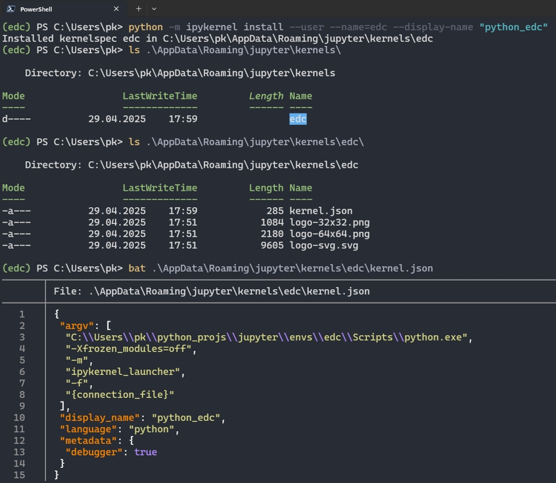

5. List kernels

   Using `jupyter kernelspec list` you can list the kernels available for Jupyter:

   ```bash
   jupyter kernelspec list
   ```

   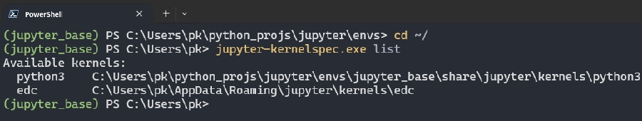

# Using jupyter

## Start `Jupyter`:

> - in the system terminal activate `jupyter_base` environment
> - write `jupyter lab` - your default web browser window should open and JupyterLab should be launched
> - write `jupyter lab --no-browser` - Jupyter server will be started, but the web browser must be launched by the user and the HTTP address must be pasted into it

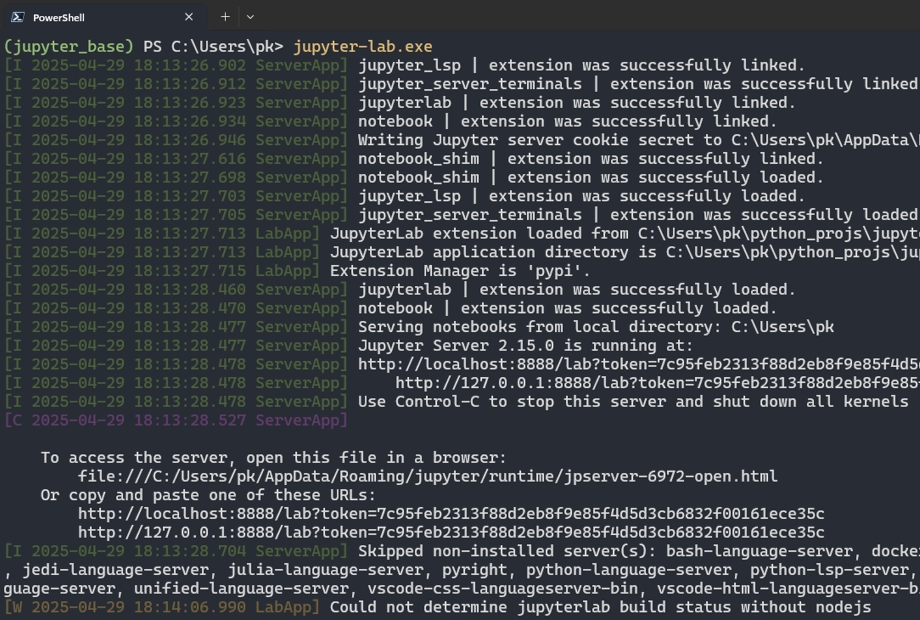
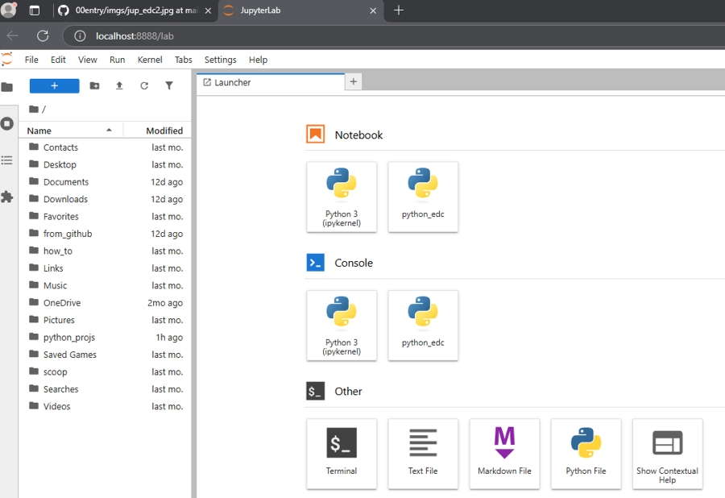

> - the command should start your default web browser and display the JupyterLab start page
> - if the start page is not displayed, copy the link displayed in the console, open the browser and paste the link

**Note:** JupyterLab starts in the current working directory. Open the terminal in the directory where you want to work before starting JupyterLab.

## Keyboard shortcuts:

- `Esc` - enters command mode
- `a` - inserts a cell above the active cell
- `b` - inserts a cell below the active cell
- `Ctrl + Enter` - runs the code stored in the cell
- `Shift + Enter` - runs the cell and selects the next cell (creates one if needed)
- `m` - changes the cell type to `Markdown`
- `y` - changes the cell type to `Code`

**Note:** The shortcuts `a`, `b`, `m` and `y` work in command mode.

## Magic commands

Magic commands run in Jupyter notebooks as in the `ipython` console. Two types of commands are available:

- line magic commands, preceded by a single `%` character, e.g. `%ls` - see [here](https://ipython.readthedocs.io/en/stable/interactive/magics.html#line-magics)
- cell magic commands, preceded by a double `%%` sign, e.g. `%%html` - see [here](https://ipython.readthedocs.io/en/stable/interactive/magics.html#cell-magics)

---


# JupyterLab Launcher

**Goal**

The goal is to create a command that launches JupyterLab directly from the command line without activating the
dedicated runtime environment `jupyter_base`.
Example:

   ```powershell
   jupyterlab
   ```


## Windows

The command is intended to be invoked from a PowerShell console.

1. Open a PowerShell console.

2. In your home directory, create a new folder named `.bin` (the name starts with a dot — this is a convention).

   ```powershell
   mkdir ".bin"
   ```

3. Enter the `.bin` directory and create a new file, for example `jupyterlab.cmd`. Use any text editor, e.g. Micro.

   ```powershell
   cd .bin
   micro jupyterlab.cmd
   ```

   **Note:**

   The file name is identical to the name of the command used to launch JupyterLab.

4. Add the following lines to the file:

   ```bat
   @echo off
   "%USERPROFILE%\python_course\jupyter\envs\jupyter_base\Scripts\python.exe" -m jupyterlab %*
   ```

   Explanation:

   - `@echo off` suppresses unnecessary output from the command interpreter.
   - `%USERPROFILE%` is the path to your Windows home directory.
   - `%*` forwards all additional command-line arguments to Python.


   **Important:**

   - The path must point to your own Jupyter runtime environment.
   - The path above assumes that `python_course` is located in your home directory.
   - The path must be enclosed in double quotes (`"`).

   Save and close the file.

5. Add the `.bin` directory to the `PATH` environment variable.

   ```text
   System -> Advanced system settings -> Environment Variables -> User PATH
   ```

   Click `New` and add:

   ```text
   %USERPROFILE%\.bin
   ```

   `%USERPROFILE%` represents your Windows home directory.

6. Restart PowerShell — the command should now be available.


## Linux / macOS

1. Open a terminal.

2. Check whether the `.local/bin` directory exists. If not, create it.

   ```bash
   mkdir -p ~/.local/bin
   ```

3. Enter the `.local/bin` directory and create a new file named `jupyterlab`. Open it for editing using any text editor, e.g. Micro.

   ```bash
   cd ~/.local/bin
   micro jupyterlab
   ```

4. Add the following lines:

   ```bash
   #!/usr/bin/env bash
   exec "$HOME/python_course/jupyter/envs/jupyter_base/bin/python" -m jupyterlab "$@"
   ```

   Explanation:

   - `#!/usr/bin/env bash` specifies the interpreter used to execute the script (shebang).
   - `exec` replaces the current shell process with the Python interpreter.
   - `$HOME` is the path to your home directory.
   - The path assumes that `python_course` is located in your home directory - replace it with your own path if necessary.
   - `"$@"` forwards all additional command-line arguments.


5. Save the file, close it, and make it executable.

   ```bash
   chmod +x jupyterlab
   ```

6. Verify that `.local/bin` is included in your `$PATH` (add it if necessary).

   For Linux (Bash):

   ```bash
   echo 'export PATH="$HOME/.local/bin:$PATH"' >> ~/.bashrc
   source ~/.bashrc
   ```

   For macOS (Zsh):

   ```bash
   echo 'export PATH="$HOME/.local/bin:$PATH"' >> ~/.zshrc
   source ~/.zshrc
   ```

